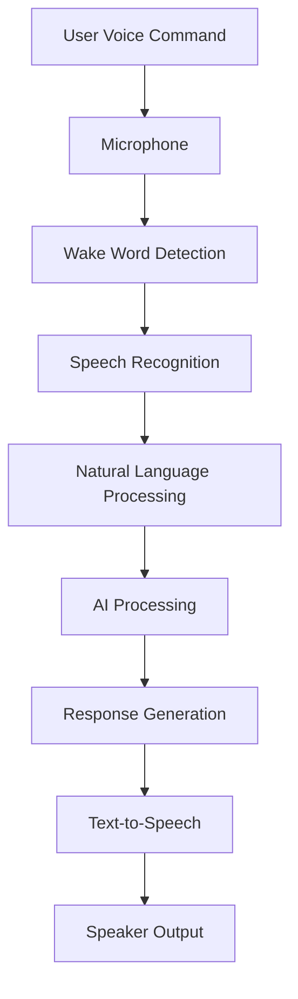

# Exploration-of-AI-Use-Case-Case-studies-on-smart-speakers
# AIM
To study the application of Artificial Intelligence in smart speakers and understand how AI technologies such as Natural Language Processing (NLP), Speech Recognition, Machine Learning, and Voice Assistant technology are used to provide intelligent services.

# THEORY
Smart speakers are electronic devices that use Artificial Intelligence (AI) to interact with users through voice commands. They are equipped with microphones, speakers, internet connectivity, and AI-based voice assistants.

Smart speakers can understand human speech, answer questions, play music, provide weather updates, set alarms, and control smart home appliances.

Examples of popular smart speakers are Amazon Echo (Alexa), Google Nest (Google Assistant), and Apple HomePod (Siri).

The major AI technologies used in smart speakers are:
1. **Speech Recognition**: Converts human speech into digital text.
2. **Natural Language Processing (NLP)**: Helps the device understand human language and commands.
3. **Machine Learning**: Learns user preferences and improves responses.
4. **Text-to-Speech (TTS)**: Converts text responses into human speech.
5. **Internet of Things (IoT)**: Enables smart speakers to control connected home devices.

# WORKING PRINCIPLE 
The working principle of a smart speaker involves the following steps:

1. **Voice Input:** The user gives a voice command through the built-in microphone.
2. **Wake Word Detection:** The device detects an activation word such as "Alexa" or "Hey Google".
3. **Speech Recognition:** The AI system converts the spoken command into text.
4. **Natural Language Processing:** NLP analyses the command and understands the user's intention.
5. **Data Processing:** The system processes the request and retrieves the required information using AI algorithms and internet services.
6. **Response Generation:** The voice assistant generates a suitable response.
7. **Voice Output:** Text-to-Speech technology converts the response into audio, which is played through the speaker.

### Working Flowchart

**Example:**

When a user says, "Alexa, play music", the smart speaker recognizes the voice command, understands the request, processes it, and plays the selected music.

# RESULT
Thus, the application of Artificial Intelligence in smart speakers was studied successfully. The working of Speech Recognition, Natural Language Processing, Machine Learning, and Voice Assistant technologies was understood. The use of AI in providing intelligent voice-based services was explored successfully.
